<picture>
  <source media="(prefers-color-scheme: dark)" srcset="assets/banner-dark.svg">
  
</picture>

 

### hi, i'm mayuri 👋

Software developer. I build backend services at work and small open-source tools in my spare time.

- ⚙️ **backend** — Java, Spring Boot, Kafka, PostgreSQL, Redis
- 🎨 **frontend** — React + TypeScript
- 📦 **open source** — handy little programs I needed myself; see the pinned repos below

 

**stack**

 

<picture>
  <source media="(prefers-color-scheme: dark)" srcset="https://raw.githubusercontent.com/api-mayuri/api-mayuri/output/languages-dark.svg">
  
</picture>

<picture>
  <source media="(prefers-color-scheme: dark)" srcset="https://raw.githubusercontent.com/api-mayuri/api-mayuri/output/snake-dark.svg">
  
</picture>

 

💬 say hi on telegram — <a href="https://t.me/api_mayuri">@api_mayuri</a>
